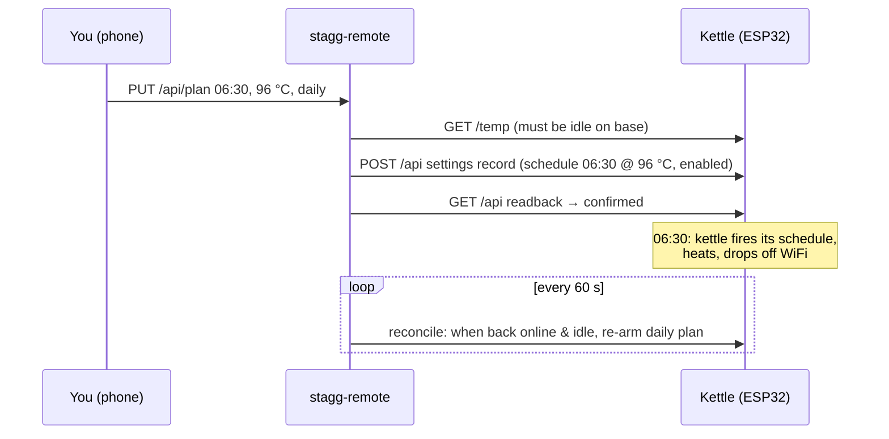

# stagg-remote

A small web app that works as a **wake-up timer** for a Fellow Stagg EKG Pro kettle on your WiFi.
You pick a time and a temperature, and the app programs the kettle's own built-in schedule over
the LAN. The kettle then starts by itself, so the app doesn't need to be running at wake time.

> ⚠️ This relies on an undocumented local interface, verified only on firmware **1.2.26**.
> The kettle's local interface has **no authentication**. Keep this app on your LAN and never expose it to
> the internet.

## How it works



See [docs/protocol.md](docs/protocol.md) for the reverse-engineered protocol and
[ADR 0001](docs/adr/0001-use-kettle-native-schedule.md) for why this approach was chosen.

## Quick start (Docker)

1. Give the kettle a fixed IP with a DHCP reservation on your router.
2. Configure and start:

   ```bash
   cp .env.example .env        # set STAGG_KETTLE_URL and TZ
   docker compose up -d --build
   ```

3. Open `http://<host>:8000` on your phone and set a wake time.

Before going to bed, leave the kettle **filled and on its base**. The app only arms the schedule
while the kettle is idle on its base. If it isn't, the plan shows as *waiting* and is armed
automatically once it is.

## Configuration

| Variable | Default | Purpose |
|---|---|---|
| `STAGG_KETTLE_URL` | (required) | e.g. `http://192.168.0.58` |
| `TZ` | `Europe/London` | Must match the kettle clock's timezone |
| `STAGG_STATE_FILE` | `/data/state.json` | Stored wake plan |
| `STAGG_RECONCILE_INTERVAL_SECONDS` | `60` | How often to check and re-arm |
| `STAGG_HTTP_TIMEOUT_SECONDS` | `5` | Kettle request timeout |

## API

Interactive OpenAPI docs are at `/docs`.

| Method | Path | Body / result |
|---|---|---|
| GET | `/api/status` | Plan, armed flag, and live kettle state, temp, clock and drift (when reachable) |
| PUT | `/api/plan` | `{"hour":6,"minute":30,"temp_c":96,"repeat":"daily"\|"once"}` → `armed` or `pending` |
| DELETE | `/api/plan` | Turns the wake-up off → `disarmed` or `pending` |
| POST | `/api/clock/sync` | Sets the kettle clock to server local time |
| GET | `/healthz` | Liveness |

## Limitations

- **One wake time.** The kettle has a single schedule slot.
- **Daily repeat is done by the app.** It re-arms the schedule after each firing, so the kettle
  must rejoin WiFi at some point before the next morning.
- **No status while heating.** The kettle drops off WiFi while it heats.
- **Firmware updates may break this.** Writes are refused on any version other than 1.2.26.

## Development

```bash
poetry install
poetry run pytest
poetry run ruff check . && poetry run ruff format --check . && poetry run mypy
STAGG_KETTLE_URL=http://192.168.0.58 poetry run uvicorn --factory stagg_remote.app:create_app --reload
```

The tests run against an in-memory fake kettle (`tests/fake_kettle.py`) built from captured records,
so they don't need a real kettle.

## Credits

The protocol groundwork comes from [bramboe/stagg-ekg-plus-ha](https://github.com/bramboe/stagg-ekg-plus-ha)
and [montymhughes/stagg-ekg-pro](https://github.com/montymhughes/stagg-ekg-pro).
